# Building an Azure Environment with Terraform

Building a complete Azure environment with Terraform, documented as I go. These lessons start with the core building blocks of a Terraform config and build up to the first real machine living in the network.

## Lesson 1: the core blocks

main.tf:

```hcl
terraform {
  required_version = ">= 1.9.0"

  required_providers {
    azurerm = {
      source  = "hashicorp/azurerm"
      version = "~> 5.0"
    }
  }
}

provider "azurerm" {
  features {}
  subscription_id = "PASTE-YOUR-SUBSCRIPTION-ID-HERE"
}

resource "azurerm_resource_group" "main" {
  name     = "rg-terraform-learn"
  location = "uksouth"

  tags = {
    Environment = "learning"
    ManagedBy   = "terraform"
  }
}
```

**terraform {} block** - the settings for Terraform itself. "required_providers" tells it to download the azurerm plugin from HashiCorp, version 5.x. required_version is just the minimum Terraform version my config will run on.

**provider "azurerm"** - a provider is the translator between Terraform and Azure's API. This block configures that plugin, telling it which subscription to talk to. The empty features {} block looks odd, but it is necessary. It's where Azure specific lifecycle behaviour gets toggled.

**resource block** - the actual thing you want to exist. Read it as "an Azure resource group which I'll call main inside my code, named rg-terraform-learn in Azure, in UK South". The main label is only for Terraform's internal references, the name is what Azure sees.

Tags are basically sticky notes on the resource. Useful later for filtering and cost tracking.

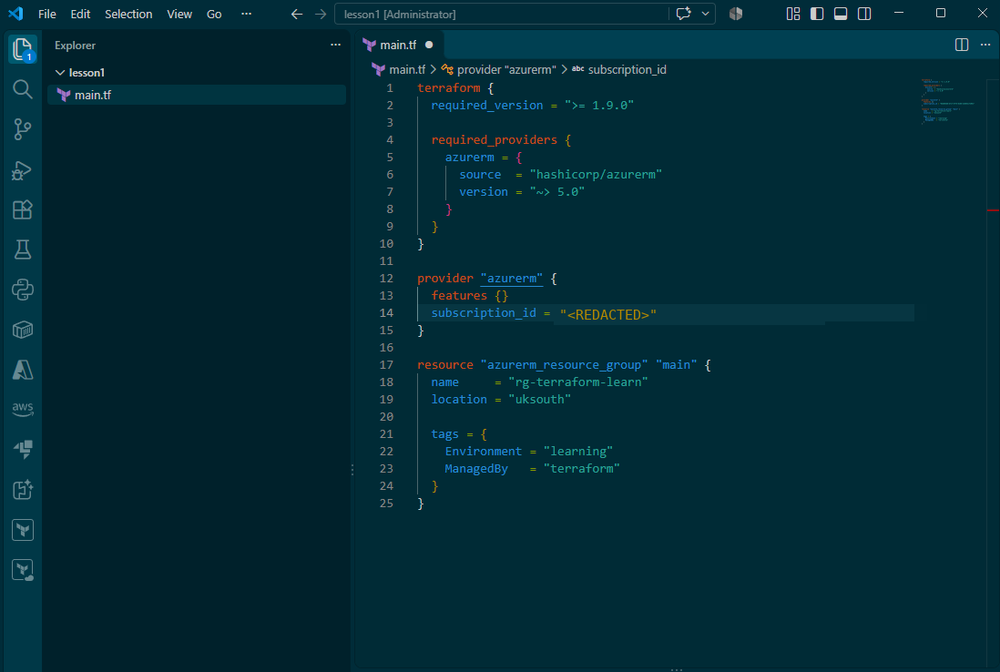

## Lesson 2: terraform init and plan

Launched Terraform with terraform init in the VS Code terminal. init downloads the azurerm plugin (the translator from lesson 1) and sets up the working directory. Nothing touches Azure yet.

Then terraform plan, the dry run. It compares my code against what actually exists in Azure and shows me what it would do without doing any of it.

The output starts with a legend explaining the symbols. A "+" in front of a line means this will be created.

```text
Terraform will perform the following actions:

  # azurerm_resource_group.main will be created
  + resource "azurerm_resource_group" "main" {
      + id       = (known after apply)
      + location = "uksouth"
      + name     = "rg-terraform-learn"
      + tags     = {
          + "Environment" = "learning"
          + "ManagedBy"   = "terraform"
        }
    }

Plan: 1 to add, 0 to change, 0 to destroy.
```

It will create azurerm_resource_group.main, with "main" being the nickname from my code. The details of the new group are in the + resource block underneath: it will live in UK South and its real name in Azure will be rg-terraform-learn. The id says "(known after apply)" because Azure only generates that once the thing actually exists.

The summary line at the bottom: 1 to add, 0 to change, 0 to destroy. That's the line to check every time before applying anything.

The environment and managedby tags come through exactly as I wrote them. Sticky notes doing their job.

## Lesson 3: terraform apply and checking the portal

Ran terraform apply. It shows the same plan again, asks you to confirm, and then actually does it. Typed yes, and the resource group was created.

New files showed up in the folder after this, including terraform.tfstate. That one deserves its own notes, so it's the next lesson.

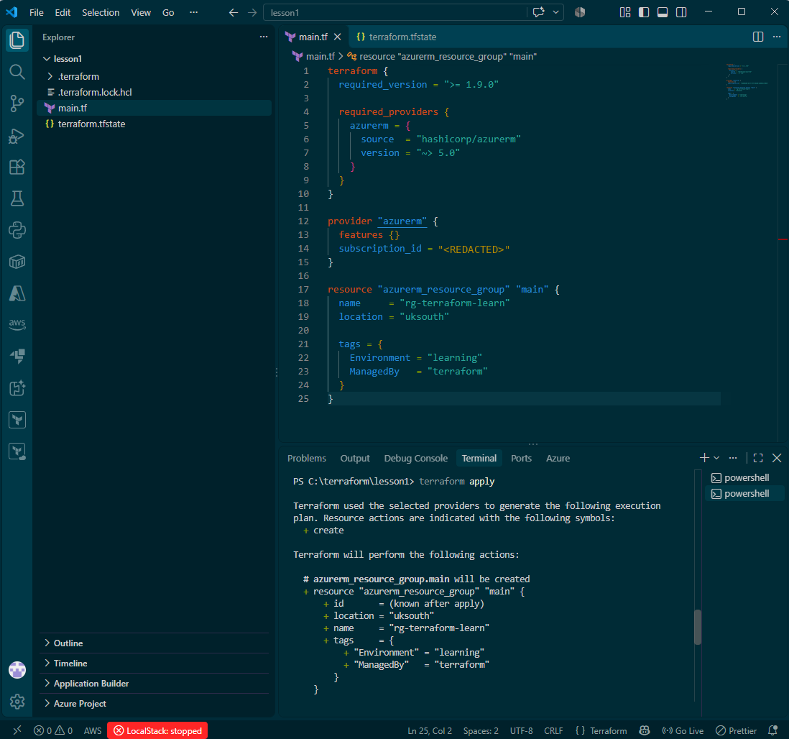

Then I went to the Azure portal to see it with my own eyes. rg-terraform-learn is there, sitting in UK South, exactly the name from my code. The main nickname stayed behind in Terraform, like it should.

The tags came through as well: Environment: learning and ManagedBy: terraform, both visible in the portal. The sticky notes made the trip.

No resources inside it yet, which is right. A resource group is just the container, and I haven't told Terraform to put anything in it. That's the next step.

One thing that clicked here: the plan said the id was "(known after apply)", and now the group exists with a real Azure-generated ID. That's the apply doing its job, turning the plan into something real.

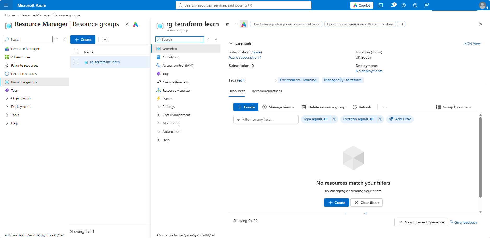

## Lesson 4: the state file, Terraform's memory

terraform.tfstate is Terraform's memory. After apply, it wrote down what it created, the resource group, along with the ID Azure gave it. It's basically a notebook of everything Terraform has built.

Two rules with this file: never edit it by hand, and never delete it. If Terraform loses this notebook, it forgets what it built and can't manage those resources any more. The resources would still exist in Azure, but Terraform would have no idea they're its.

This is also what makes plan work. When I next run terraform plan, Terraform reads this notebook and compares three things: what my code says, what I built last time, and what actually exists in Azure right now. Then it computes the diff, and that diff is the plan.

So the loop from here is: change the code, plan reads the notebook and shows the diff, apply makes it real and updates the notebook.

(Also worth repeating: this file does not get committed to git. It can hold sensitive values, and it's a local working file, not source code.)

## Lesson 5: variables, or labelled boxes

Right now my main.tf has three values hard-coded: the location, the resource group name, and the environment tag. That works today, but it won't scale. Values like location are going to show up in other places as the environment grows (network, VMs, all of it). Writing the same thing in 10 different locations means changing one means changing the other 9, and if I miss one, I've got a broken environment.

The fix is labelled boxes that I define once at the top of the project. I won't write "uksouth" directly any more, I'll write "whatever is in the box labelled location". Change the box's contents once, and every resource that reads from it updates.

So I've created a variables.tf file (a separate file, keeps main.tf clean) and started defining the boxes:

```hcl
variable "location" {
  type        = string
  default     = "uksouth"
  description = "Which Azure region everything goes in"
}

variable "resource_group_name" {
  type        = string
  default     = "rg-terraform-learn"
  description = "Name of the resource group"
}

variable "environment" {
  type        = string
  default     = "learning"
  description = "Environment tag value"
}
```

Reading one of these back:

- `variable "location"` means I'm creating a box labelled "location".
- `type = string` means this box only holds text. Other types exist too, like number and bool (true/false), so a box can refuse the wrong kind of contents.
- `default = "uksouth"` means if nobody inputs otherwise, the box contains this region.
- `description` is just a note to keep things organised. Future me will thank present me.

The boxes are defined, but main.tf still has the hard-coded values in it. Next step is swapping them out for references to the boxes, so the resource group reads its name and location from variables instead of strings I typed by hand.

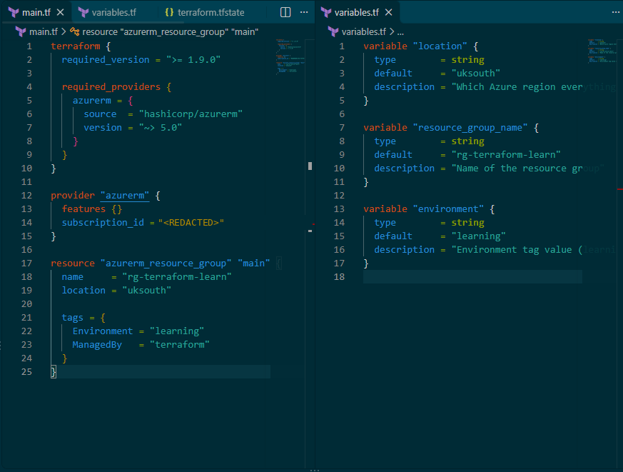

## Lesson 6: reaching into the boxes

Did the swap. Edited the resource block in main.tf so it reaches into the boxes instead of holding hard-coded values. The resource group now reads like this:

```hcl
resource "azurerm_resource_group" "main" {
  name     = var.resource_group_name
  location = var.location

  tags = {
    Environment = var.environment
    ManagedBy   = "terraform"
  }
}
```

The syntax is var.thelabel. So var.resource_group_name means "whatever is in the box labelled resource_group_name". Three strings gone, three box references in.

One I deliberately left alone: ManagedBy = "terraform" stays hard-coded. That value should never change, everything in this project is managed by Terraform by definition, so there's no box needed for it. Boxes are for values that might change or get reused, not for constants.

Worth noting: no quotes around the var references. "var.location" in quotes would be the literal text, var.location without quotes is the box lookup.

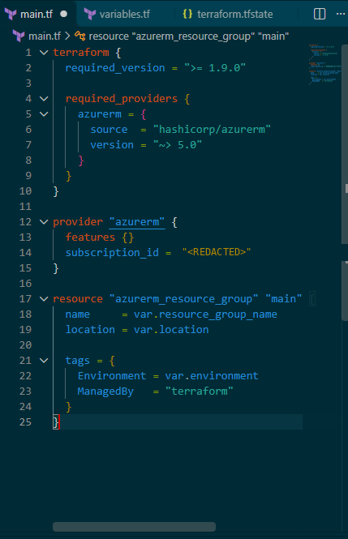

## Lesson 7: outputs, or the receipt

An output is me telling Terraform: after applying, print this specific value to my terminal. Like a receipt after a purchase, letting me know what I got. Specifically, it's how I make Terraform hand over that mysterious ID, the one the plan kept calling "(known after apply)".

Created an outputs.tf file, same pattern as variables.tf, separate file, main.tf stays clean:

```hcl
output "resource_group_id" {
  value       = azurerm_resource_group.main.id
  description = "The full Azure ID of the resource group"
}

output "resource_group_location" {
  value       = azurerm_resource_group.main.location
  description = "Where the resource group lives"
}
```

Reading the first one: `output "resource_group_id"` is creating a receipt line called resource_group_id. The value line is the new syntax bit: `azurerm_resource_group.main.id` means "from that resource, give me its id attribute".

Breaking that down:

- `azurerm_resource_group` is what kind of thing it is
- `main` is the nickname (there's the label from lesson 1 doing its job)
- `.id` is which attribute I want off it. Could just as easily be .name, .location, .tags, whatever the resource has

I added a second receipt line for the location too, cheap to do and handy to see. After the next apply, both print to the terminal, and I can pull them up again any time with terraform output.

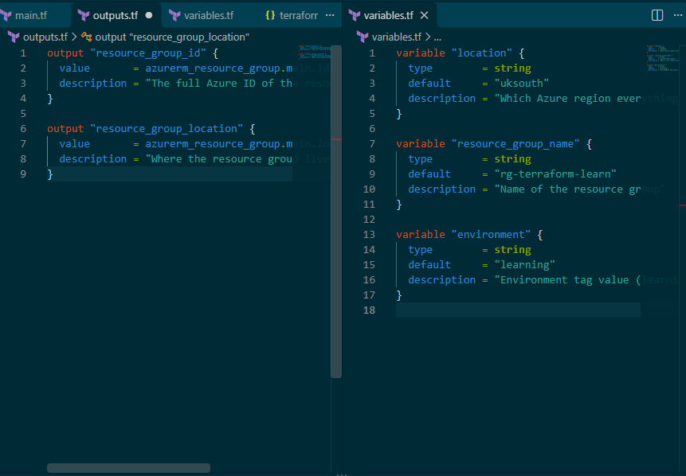

## Lesson 8: the network skeleton

Time to build the network skeleton that all future resources (VMs, databases, whatever comes next) will live in. This is the first real piece of the environment beyond the container.

Created network.tf for it. The project files now have a clear split: main.tf is the core, variables.tf is the inputs, outputs.tf is the receipts, network.tf is the networking. Terraform doesn't care which file what lives in, it reads them all together, this split is for human organisation. Makes things easy to find months later.

```hcl
resource "azurerm_virtual_network" "main" {
  name                = "vnet-terraform-learn"
  location            = var.location
  resource_group_name = azurerm_resource_group.main.name
  address_space       = ["10.0.0.0/16"]
}

resource "azurerm_subnet" "web" {
  name                 = "web"
  resource_group_name  = azurerm_resource_group.main.name
  virtual_network_name = azurerm_virtual_network.main.name
  address_prefixes     = ["10.0.1.0/24"]
}

resource "azurerm_subnet" "database" {
  name                 = "database"
  resource_group_name  = azurerm_resource_group.main.name
  virtual_network_name = azurerm_virtual_network.main.name
  address_prefixes     = ["10.0.2.0/24"]
}
```

What it does:

- `azurerm_virtual_network` creates our private network, the neighbourhood to our subnet streets. The address range 10.0.0.0/16 gives 65,536 addresses. Big on purpose, it leaves room to grow.
- The two `azurerm_subnet` blocks divide the network into streets: web (10.0.1.0/24, 256 addresses) and database (10.0.2.0/24). (Small print: Azure reserves 5 addresses per street for itself, so it's 251 usable in practice.) The security boundaries come later, that's where I'll get to say things like "database only accepts traffic from web".
- `resource_group_name = azurerm_resource_group.main.name` is saying: take the name fact off the resource group's fact sheet. Same reference syntax as the outputs lesson. Terraform sees these links and builds resources in the right order automatically, resource group first, then the VNet, then the subnets. I never told it that order, it worked it out from the references.

One inconsistency I've spotted in my own code: the VNet name is hard-coded ("vnet-terraform-learn") while the location comes from a box. Lesson 5 me would say that name belongs in variables.tf. Leaving it for now, but noting it.

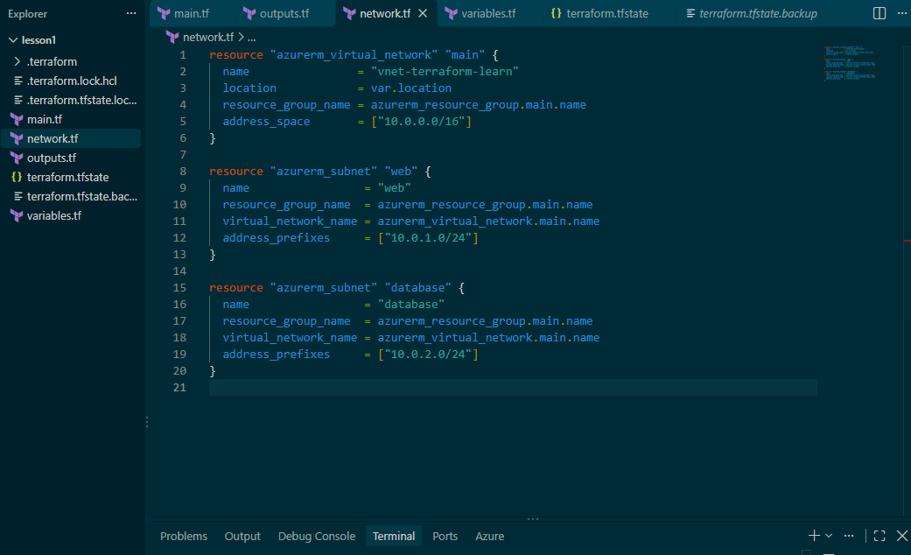

## Lesson 9: the first failure, resource provider not registered

Ran the apply for the network skeleton and it failed. First proper error of the project. The VNet wouldn't create because my Microsoft network switch was off, Azure's words were "the resource provider isn't registered".

What's actually going on: every service family in Azure (networking, compute, storage, and so on) sits behind a switch on your subscription called a resource provider. A new subscription doesn't have them all on. The azurerm provider 5.x doesn't auto-register them for you, so the first time you use a service family on a new subscription, the switch is off and the apply bounces.

The error signature to recognise: **409 MissingSubscriptionRegistration**.

The fix is a one-time command, flick the switch for networking:

```
az provider register --namespace Microsoft.Network
```

Once that finished, the apply went through and the VNet and both subnets landed. You can check a switch's state any time with `az provider show --namespace Microsoft.Network --query registrationState`, it should say Registered.

Lesson learned: new subscription plus first time using a service family equals run the register command once. Storage and compute may need the same treatment when I get to them (Microsoft.Storage, Microsoft.Compute), so that's the first thing I'll check if an apply bounces with a 409.

TLDR: azurerm provider 5.x doesn't auto-register Azure resource providers. New subscription + first time using a service family = run `az provider register --namespace Microsoft.X` once. Error signature: 409 MissingSubscriptionRegistration.

## Lesson 10: the first machine (compute.tf)

The network skeleton is up, time to put a machine in it. New file, compute.tf, keeping the split: main.tf is core, variables.tf is inputs, outputs.tf is receipts, network.tf is networking, compute.tf is the VM and everything it needs to exist.

A VM in Azure is not one resource, it is a small pile of them. The pieces:

**The VM itself.** Ubuntu Linux. Reasons: it is cheap, it boots in seconds on a small size, and you manage it over SSH and the command line, which is the industry norm for servers. Also, most cloud VMs run Linux (around 70 percent), so this is the skill that matters.

**The network interface (NIC).** The VM's network card. A VM cannot touch a subnet directly, the NIC is the cable that plugs it into the web subnet. Everything network related hangs off the NIC, not the VM.

**The public IP.** A front door address on the internet, attached to the NIC so I can reach the VM from my PC. Without it the VM only has its private 10.0.1.x address, reachable from inside the network only.

**The network security group (NSG).** The firewall. One rule only: allow SSH in on port 22, everything else stays blocked. Port 22 is the door number for SSH, the protocol for securely controlling a remote machine's command line, which is exactly what I need to do. Port 3389 would be RDP for Windows remote desktop, not needed here. Ports 80 and 443 are for web traffic, which this VM does not serve yet, those get added the day I install a web server.

One detail worth noting: the firewall does not attach to the VM, it attaches to the NIC, through a separate association resource. Firewall clips onto the cable, not the computer.

The code (the visible parts):

```hcl
# the one NSG rule, inside azurerm_network_security_group "web"
security_rule {
  # ...
  destination_port_range     = "22"
  source_address_prefix      = "*"
  destination_address_prefix = "*"
}

resource "azurerm_network_interface" "vm" {
  name                = "nic-terraform-learn"
  location            = var.location
  resource_group_name = azurerm_resource_group.main.name

  ip_configuration {
    name                          = "internal"
    subnet_id                     = azurerm_subnet.web.id
    private_ip_address_allocation = "Dynamic"
    public_ip_address_id          = azurerm_public_ip.vm.id
  }
}

resource "azurerm_network_interface_security_group_association" "vm" {
  network_interface_id      = azurerm_network_interface.vm.id
  network_security_group_id = azurerm_network_security_group.web.id
}

resource "azurerm_linux_virtual_machine" "main" {
  name = "vm-terraform-learn"
  # ...
}
```

Two things worth noticing in there. The NIC pulls its subnet and public IP off other resources' fact sheets (azurerm_subnet.web.id, azurerm_public_ip.vm.id), same reference pattern as always. And the NSG does not attach inside the NIC block or the NSG block, it gets its own association resource gluing the two together. Terraform treats the wiring as a thing in its own right.

### Least exposure

The principle behind the single rule: every open port is a door an attacker can try. A server with 10 open ports has 10 doors. Ours has one.

### The key

In the VS Code terminal: `ssh-keygen -t ed25519`. Reading it back: ssh-keygen is "make me a key pair", -t ed25519 is "of type ed25519". Why that type: it is modern, the keys are short, it is fast, and it has been the recommended default since 2020. The old workhorse is `-t rsa -b 4096`, but RSA keys are huge and slower, and that option is really for ancient systems now.

The pair matters: a public key goes on the VM, the private key stays on my PC. Password login is disabled entirely, the key is the only way in.

### The star, and why it is a calculated risk

The NSG rule's source is `"*"`, and it is worth understanding what the source fields actually mean, because they are about the caller, the computer trying to reach the VM:

- `source_address_prefix` is WHERE the caller is calling from. `"*"` means any IP in the world.
- `source_port_range` is which line the caller is using to place the call. When my PC calls out, it grabs a random high number as its line for that one conversation, so it can hold hundreds of connections at once without mixing them up. So the VM answers on 22, and the replies come back to something like 52341 on my end.

Reading the whole rule back in one sentence: allow any caller (source_address_prefix = "*"), calling from whatever line they happen to use (source_port_range = "*"), to reach port 22 on our side (destination_port_range = "22").

Leaving the source as `"*"` is not ideal. Bots scan the internet constantly, and they will find the VM and start trying to log in within minutes, you can watch them in the logs. It is acceptable here for one reason only: password login is disabled and the private key is the only way in. The door is visible, but it is vaulted shut. Trying is all they can do.

The proper fix, when it matters: replace `"*"` with my home IP, something like 86.143.22.9/32 (example address). Then the door is invisible to everyone except me.

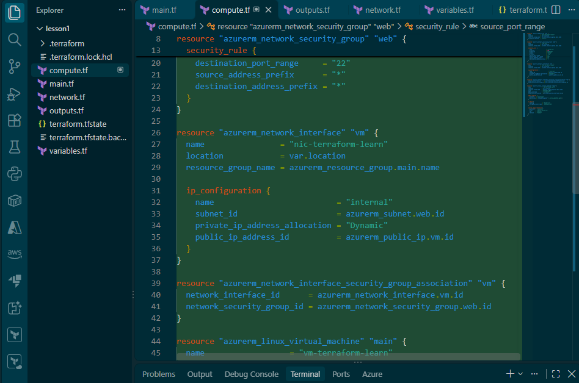

## Lesson 11: the plan before the machine

Before applying compute.tf, ran terraform plan. Two things in the output worth writing down, and one hygiene note.

**The refresh.** The first four lines of the output are "Refreshing state" against the four existing resources: the resource group, the virtual network, and the web and database subnets. That is everything from lessons 1 and 8. Refreshing means Terraform is re-reading the real world and updating its notebook (lesson 4) before it computes anything. The 4 are not being changed, they are being checked.

**The diff.** The summary line: `Plan: 5 to add, 0 to change, 0 to destroy.` The 5 are exactly the pile from lesson 10: the VM, the NIC, the public IP, the NSG, and the association that clips the firewall to the cable. Nothing existing gets touched.

Three details from the body of the plan:

- In the VM block: `ssh-ed25519 AAAA... user1@DESKTOP-NQGM9HQ`. My public key, read off disk correctly by the admin_ssh_key block. The private half never leaves my PC.
- In the NIC block: `subnet_id = "/subscriptions/.../resourceGroups/rg-terraform-learn/.../subnets/web"`. The reference azurerm_subnet.web.id has solved into a real Azure resource ID. The whole chain works: VM points at NIC, NIC points at subnet, subnet points at VNet, VNet points at the resource group. Terraform worked out the build order from those links, just like lesson 8 said it would.
- In the outputs: `+ vm_public_ip = (known after apply)`. Added a new receipt line for the front door address, same pattern as lesson 7. After apply, the real public IP prints to the terminal.

Hygiene note to self: Azure resource IDs contain the subscription ID, so plan output gets that part masked before it goes anywhere public, this log included.

Next: the apply. Five resources, one machine, and a receipt with my front door address on it.

## Lesson 12: the same 409, a different switch

Ran terraform apply for the compute pile and typed yes. Got to watch the dependency order from lesson 8 happen live first: the NSG and the public IP created at the same time (they only need the resource group), then the NIC (needs the subnet and the public IP), then the association (needs the NIC and the NSG), and the VM went last, because it needs everything else to exist first.

Then it bounced. Error: 409 MissingSubscriptionRegistration. The exact same error as lesson 9, just a different switch: this time the namespace that is not registered is Microsoft.Compute, not Microsoft.Network. Lesson 9 literally said "storage and compute may need the same treatment when I get to them", and here we are. Called it.

The fix is the same one simple command, different namespace:

```
az provider register --namespace Microsoft.Compute
```

Where this leaves things: 4 of the 5 resources from the plan are built and written in the notebook (the NSG, the public IP, the NIC, the association). Only the VM is missing. Once the register command finishes, re-run apply and the plan should say 1 to add, just the VM. Nothing gets duplicated, because the notebook remembers what already exists (lesson 4).

Lesson learned, again: new subscription plus first time touching a service family equals run the register command once. The signature is the same every time, 409 MissingSubscriptionRegistration, and the error message names the exact namespace to register. No guessing.

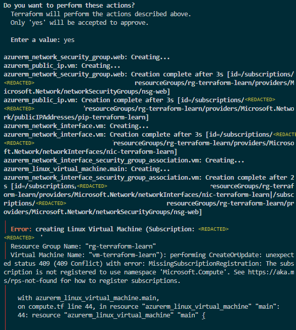

## Lesson 13: the shop is out of stock (SkuNotAvailable)

Registered the compute switch, re-ran apply, and the plan said exactly what lesson 12 predicted: 1 to add, just the VM. Typed yes. New error.

The message that matters this time: SkuNotAvailable: The requested VM size 'Standard_B1s' is currently not available in location 'uksouth'.

Translation: Azure's UK South datacentre has run out of spare capacity for the B1s size specifically. My code is fine, the shop is just out of stock on that shelf. This happens with the cheapest sizes, because everyone wants them.

Important note: this is the same HTTP status as lesson 12 (409), but a completely different cause. Always read the error code that comes after the status, SkuNotAvailable vs MissingSubscriptionRegistration. The status code alone tells you nothing.

The fix: pick a size that is in stock. Went into compute.tf and changed size = "Standard_B1s" to size = "Standard_B2s", ran apply again. Same error. B2s is out of stock in uksouth too.

Next attempt: size = "Standard_B2ats_v2". Except there was a typo detour before I even got the spelling right (next lesson), and the size hunt turned out to be nowhere near over (the lesson after that).

Note to self: there is a way to check the shelves before guessing. `az vm list-skus --location uksouth --size Standard_B --all --output table` shows which B sizes the subscription can actually get in that region (check the restrictions column). Doing that first next time, instead of trial and error.

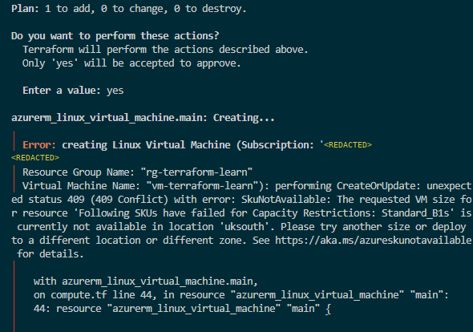

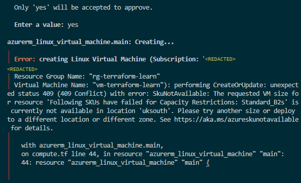


## Lesson 14: the typo in between, size names are exact

Honest footnote to lesson 13. Between B2s failing and the correctly spelled B2ats_v2 attempt, I made a mistake and typed the size wrong.

In compute.tf I put size = "Standard_B2ats/v2 family". That is not a size name, that is the family description I had written down, copied straight in without thinking. Azure's reply was a new flavour of error again:

400 Bad Request, InvalidParameter: The value Standard_B2ats/v2 family provided for the VM size is not valid.

So not out of stock this time, just not a real thing. Size names are exact strings: Standard_B2ats_v2. No slashes, no spaces, no "family" on the end, it is underscores all the way.

The useful part of this error: it lists every valid size in the region after the complaint, hundreds of them. The fix was literally inside the error message, I just had to read it and copy one exactly.

Also worth noting: terraform plan did not catch this. To Terraform the size is just a string, it has no idea what sizes exist. Only Azure knows, and it only gets asked at apply time. So a plan with no complaints is not a guarantee, it just means the shape of the code is right.

The running tally for the project so far: 409 MissingSubscriptionRegistration (switch was off), 409 SkuNotAvailable (out of stock), 400 InvalidParameter (my typo). Three failures, three different causes, same lesson every time: the bit after the status code is the bit to read.

Corrected compute.tf, full VM block visible: the key read off disk with file(pathexpand("~/.ssh/id_ed25519.pub")), the disk settings, the Ubuntu image reference, and the receipt line for the public IP at the bottom ("this is what you SSH to").

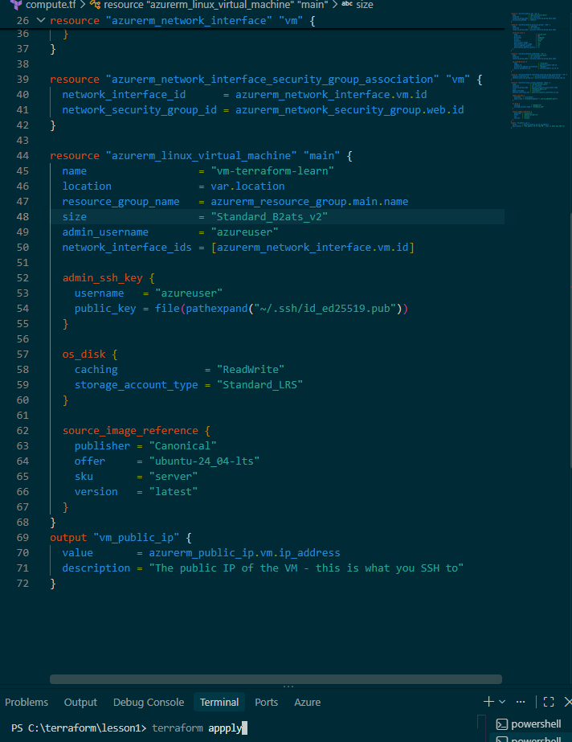

## Lesson 15: the size hunt, or how a trial subscription boxes you in

The full story of what lessons 13 and 14 were actually part of. The tally: 12 applies, 9 different sizes, 2 regions, 1 typo. Every single one red, until the very last one.

| # | Size tried | Region | Result |
|---|-----------|--------|--------|
| 1 | Standard_B1s | uksouth | SkuNotAvailable |
| 2 | Standard_B2s | uksouth | SkuNotAvailable |
| 3 | Standard_B2ats/v2 family | uksouth | InvalidParameter (my typo, lesson 14) |
| 4 | Standard_B2ats_v2 | uksouth | SkuNotAvailable |
| 5 | Standard_D2s_v3 | uksouth | SkuNotAvailable |
| 6 | Standard_D2as_v5 | uksouth | SkuNotAvailable |
| 7 | Standard_D2s_v5 | uksouth | SkuNotAvailable |
| 8 | Standard_B2ms | uksouth | SkuNotAvailable |
| 9 | Standard_A2_v2 | uksouth | BadRequest |
| 10 | (region moved to ukwest, one variable) | | |
| 11 | Standard_B2s | ukwest | SkuNotAvailable |
| 12 | Standard_D2als_v7 | ukwest | **Apply complete** |

**The region move.** At one point the theory was "uksouth is just dry, try another region". The move itself was one line: edit variables.tf, set default = "ukwest", save, terraform plan. That is lesson 5 paying for itself, one box changed and the whole environment planned to move. The results were the same though, B2s bounced in ukwest too. Region was never the real problem.

Side effect of the move, noticed after the fact: the whole environment now lives in ukwest, built by Terraform from the same code that built uksouth. That is the reproducibility test from the roadmap, passed by accident. Same code, different region, whole network back up.

**The real discovery.** This is a trial subscription. Trial subs are blocked from many VM families, and the only unrestricted ones available to me were the newer v7 families. First v7 attempt, Standard_D2als_v7, went straight through.

**For future reference:** trial subscription blocked from many families. The fix is either an allowed size (v7 here) or a quota increase request through support.

**The reflection, because it matters.** This was probably the most exhaustive part of the project so far, but it was never a knowledge or learning problem. The code was right the entire time (one typo aside). It was account restrictions the whole way, and no amount of studying fixes that. Knowing the difference between "I got this wrong" and "the platform said no" is its own skill.

**And a coda for lesson 13's note to self.** The az vm list-skus command would have been genuinely useful here for once: on a restricted subscription, run it first with --all and only shortlist sizes whose Restrictions column is empty. It still cannot see live capacity, but it can see a locked door, and a trial subscription is a corridor full of locked doors.

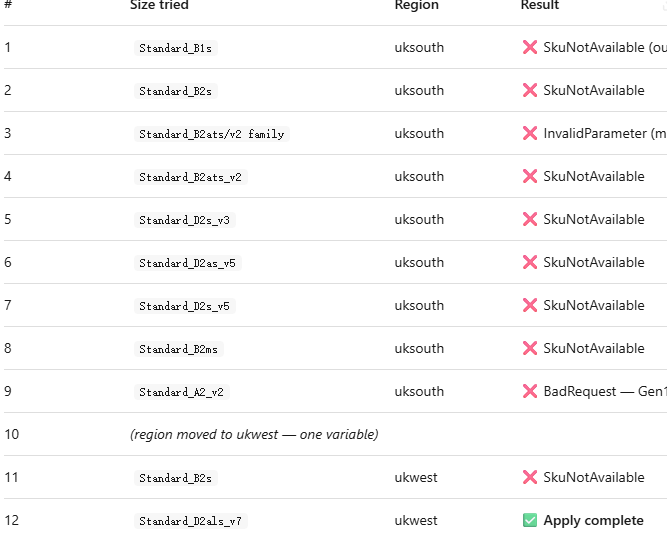

## Lesson 16: first contact, SSH into the machine

**Getting the address.** terraform output vm_public_ip, and there it was. The "(known after apply)" from lesson 11 is now known. This is what the outputs.tf block was for: Terraform captured the value at apply time and stored it in the notebook, and terraform output re-reads the receipt any time without touching Azure. We need this address because it is the front door we are about to knock on with SSH.

**Knocking.** ssh azureuser@ the receipt. Reading that back: connect as azureuser (the admin account we declared in code), to the public IP, through port 22 of course, the one NSG rule we opened. No password gets typed. The SSH client proves it holds the private key that matches the public key we installed on the VM.

First knock actually got "Connection closed by ... port 22". Most likely the VM was still finishing its first boot: apply saying complete means Azure finished building the machine, not that Ubuntu had finished waking up. Second knock, straight in.

The yes prompt on the way in: SSH saying "first contact, remember this machine's identity so you can detect impostors later". The fingerprint gets saved into known_hosts, and if a different machine ever answers at this address in future, SSH will scream about it.

**Verification, three commands:**

- whoami said azureuser. The login worked, and we are the account we declared in code.
- hostname said vm-terraform-learn. Our machine, not some random server.
- ip addr is the big one. eth0 is the VM's network card, the azurerm_network_interface block we wrote, and it shows inet 10.0.1.4/24. An address off our web street. Why .4: Azure reserves 5 addresses per subnet, .0 is the network itself, .1 the gateway, .2 and .3 DNS, .255 broadcast, so .4 is the first house number a machine can actually take. Our VM got house number 4 on the street we designed back in lesson 8.

The login banner spoils it before you even run anything: "IPv4 address for eth0: 10.0.1.4". Then exit, and I am back on my own machine.

The terminal, trimmed (real public IP masked, this log goes public):

```text
PS C:\terraform\lesson1> ssh azureuser@<masked>
Welcome to Ubuntu 24.04.5 LTS (GNU/Linux 7.0.0-1017-azure x86_64)
  IPv4 address for eth0: 10.0.1.4

azureuser@vm-terraform-learn:~$ whoami
azureuser
azureuser@vm-terraform-learn:~$ hostname
vm-terraform-learn
azureuser@vm-terraform-learn:~$ ip addr
2: eth0: <BROADCAST,MULTICAST,UP,LOWER_UP> mtu 1500 qdisc mq state UP group default qlen 1000
    inet 10.0.1.4/24 metric 100 brd 10.0.1.255 scope global eth0
azureuser@vm-terraform-learn:~$ exit
```

The summary of the whole compute arc: a VM is never one resource, it is five blocks wired together by references (public IP, firewall, NIC, association, machine), and SSH keys are how you prove identity without passwords.

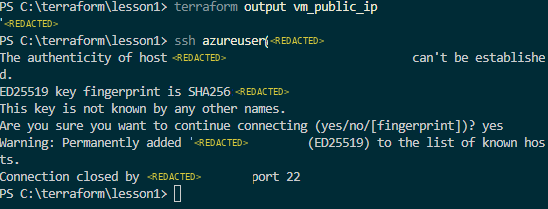

## Lesson 17: the notebook moves to Azure (remote state and locking)

So the notebook (terraform.tfstate) has been living only on my device this whole time. Everything so far worked, but if I lose that file, Terraform forgets everything it has ever built, and the whole inventory from lesson 4 dies with it. Time to give it a proper home: Azure Storage. Backed up, shareable, and locked. The locked part matters more than it sounds: two people cannot run apply at the same time and corrupt the file. The azurerm backend takes a lease on the state blob for the whole operation, so a second apply has to wait its turn instead of trampling the first one.

**Why az and not Terraform for this bit.** Chicken and egg. Terraform needs the storage to exist before it can store anything there, so the state's home is the one thing Terraform cannot build for itself. Four commands did it:

```powershell
az provider register --namespace Microsoft.Storage
az group create --name rg-terraform-state --location ukwest
az storage account create --name tfstatelearn1990 --resource-group rg-terraform-state --sku Standard_LRS
az storage container create --name tfstate --account-name tfstatelearn1990
```

First line is lessons 1 and 12 paying off again: register the provider before Azure throws the 409 at me. Storage account names have rules: globally unique across all of Azure, lowercase, no dashes allowed at all, which is why digits do the heavy lifting. tfstatelearn1990 it is. Standard_LRS means locally redundant copies, cheapest option, fine for a notebook. The container command printed a warning about no credentials in the command, then quietly queried the account key by itself and answered "created": true.

**Pointing Terraform at it.** Back in main.tf, inside the terraform block, above required_providers:

```hcl
backend "azurerm" {
  resource_group_name  = "rg-terraform-state"
  storage_account_name = "tfstatelearn1990"
  container_name       = "tfstate"
  key                  = "lesson1.tfstate"
}
```

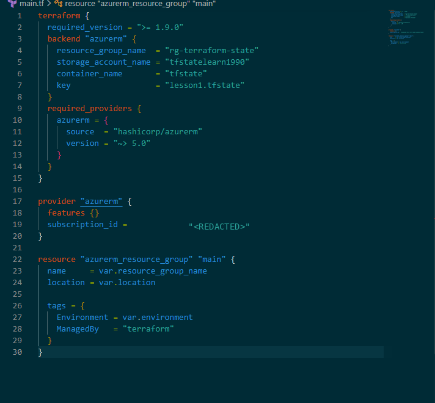

Worth expanding on what this block actually is, because it sits in the same file as the resource blocks but it is not one of them. Every other block in my code describes a thing I want to exist in Azure. The backend block describes nothing in Azure at all. It is core Terraform configuration: instructions for the tool itself, telling it where the notebook lives. That is why it shares the terraform block with required_version and required_providers, which are also settings for the tool, not infrastructure. Three consequences fall out of that:

- It creates nothing. No apply will ever build a backend, which is exactly why the storage had to be made by hand with az first.
- It cannot use variables. Terraform reads the backend block before it has even loaded the variables, so the four values have to be typed literally. var.location in there would fail.
- Changing it means re-running init. You changed how Terraform works, not what it manages, and Terraform itself says so in the init output: rerun this command if you ever set or change modules or backend configuration.

The key line is just the filename the notebook gets inside the container: lesson1.tfstate.

**The move.** terraform init -migrate-state. init because the backend configuration changed, and -migrate-state because there was already a local notebook to carry over rather than starting blank. The reply: "Successfully configured the backend "azurerm"!" followed by the usual "Terraform has been successfully initialized!". The local tfstate got uploaded and the job handed over. From now on, every plan and apply reads and writes the blob in Azure, not a file on my disk.

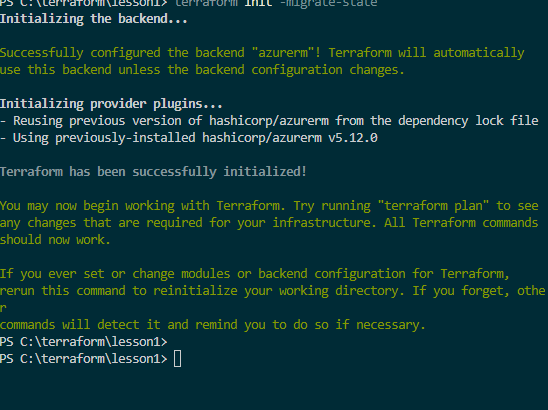

**Check 1, the portal (visual proof).** Portal, resource group rg-terraform-state, storage account tfstatelearn1990, left menu Data storage, Containers, click tfstate. One blob sitting there: lesson1.tfstate, 20.28 KiB, block blob, Hot (inferred) tier, lease state Available. Available means nobody is mid-apply right now. The moment someone runs plan or apply, that lease flips to Leased and everyone else has to wait. The notebook has an official home, and the home has a bouncer.

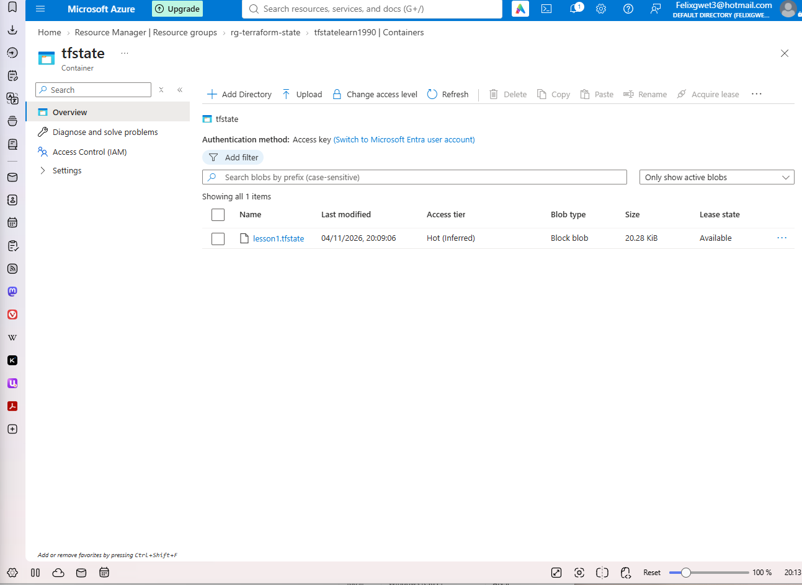

Hygiene note for future me: the tfstate contains real resource IDs and can contain secrets, which is why it never goes in git. Now it does not even live next to the code.

That is roadmap item 5 done: remote state and locking, what real teams use. Next up: the SQL database on the database street from lesson 8 (the one that only accepts traffic from web), or item 6, modules and environments.
