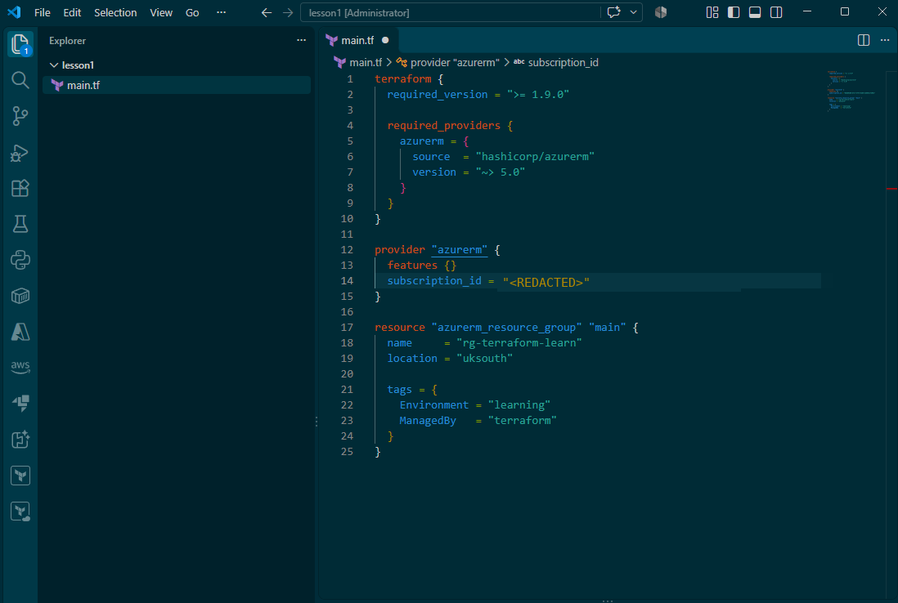

# Lesson 1: Terraform Fundamentals and the Core Blocks

First proper step in building out a full Azure environment with Terraform. Before touching any real infrastructure, I wanted to get the core building blocks of a Terraform config down properly, because everything else builds on these.

## The code

`main.tf`:

```hcl
terraform {
  required_version = ">= 1.9.0"

  required_providers {
    azurerm = {
      source  = "hashicorp/azurerm"
      version = "~> 5.0"
    }
  }
}

provider "azurerm" {
  features {}
  subscription_id = "PASTE-YOUR-SUBSCRIPTION-ID-HERE"
}

resource "azurerm_resource_group" "main" {
  name     = "rg-terraform-learn"
  location = "uksouth"

  tags = {
    Environment = "learning"
    ManagedBy   = "terraform"
  }
}
```

## The terraform {} block

This block holds the settings for Terraform itself, not for anything in Azure. Two things happening in mine:

- `required_version = ">= 1.9.0"` sets the minimum Terraform version the config will run on.
- `required_providers` tells Terraform to download the azurerm plugin from HashiCorp, pinned to version 5.x. The `~> 5.0` constraint means any 5.x release, which gets me bug fixes without surprise breaking changes from a major version bump.

## The provider block

A provider is the translator between Terraform and Azure's API. Terraform speaks HCL, Azure speaks REST, the provider sits in the middle and does the conversion.

The `provider "azurerm"` block configures that plugin. In my case that's which subscription it should talk to via `subscription_id`.

The empty `features {}` block looks odd at first, but it's required. It's where Azure specific lifecycle behaviour gets toggled on and off (things like what happens to resources inside a resource group when you delete it). Even if you want all the defaults, the block has to be there or the provider throws an error.

## The resource block

This is the actual thing I want to exist. Reading it in plain English: "an Azure resource group, which I'll call main inside my code, named rg-terraform-learn in Azure, located in UK South".

The important distinction, and the one that tripped me up at first:

- The label `main` is only for Terraform's internal references. Elsewhere in the code I'd point to it as `azurerm_resource_group.main`.
- The `name` argument is what Azure actually sees in the portal.

The label never leaves my codebase. The name is what shows up when I log into Azure.

## Tags

Small thing, but worth building the habit early. Tagging everything from day one (`Environment = "learning"`, `ManagedBy = "terraform"`) makes it trivially easy to see at a glance what's managed by Terraform versus something someone clicked together in the portal, and it pays off later for cost tracking and cleanup.

## Screenshot


